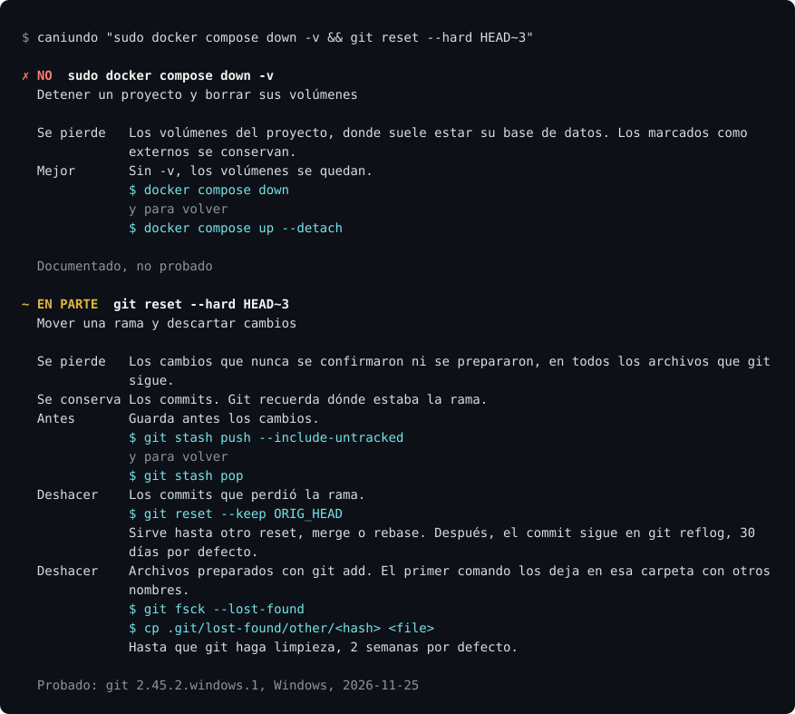

<h1 align="center" id="title">CANIUNDO</h1>

<p align="center"></p>

<p id="description">Un solo comando puede borrar una base de datos, una rama o una semana de trabajo, y casi todas las herramientas solo te dicen que es peligroso. caniundo te dice qué se perdería, qué hacer en su lugar y cómo recuperarlo. Es una base abierta que cualquiera puede ampliar, y una ficha solo se llama probada cuando sus recetas se ejecutaron de verdad y todo volvió. Funciona como skill para Claude, dentro de Claude Code, en tu terminal y en la web.</p>

<p align="center">
<a href="https://github.com/willor16/caniundo"></a>
<a href="https://github.com/willor16/caniundo/actions/workflows/ci.yml"></a>

<a href="LICENSE"></a>
</p>

<p align="center"><a href="README.md">🌎 Read in English</a></p>

<h2>🚀 Demo</h2>

[willor16.github.io/caniundo/es](https://willor16.github.io/caniundo/es/)

<h2>📸 Capturas:</h2>

<p align="center"></p>

<h2>🧐 Características</h2>

*   99 comandos, 53 de ellos probados por ahora
*   Dice qué se pierde, qué se conserva, qué hacer en su lugar y cómo deshacerlo
*   Encuentra el comando dentro de `sudo`, `bash -c`, `docker exec`, `xargs`, `ssh` y otros
*   Una skill para Claude.ai, Claude Desktop y Claude Code, sin instalar nada
*   Detiene a Claude Code antes de que ejecute algo que no se puede deshacer
*   Entiende Bash, PowerShell y SQL
*   Todo en español e inglés

<h2>🛠️ Instalación:</h2>

Necesitas [Node.js](https://nodejs.org) 20 o posterior.

<p>1. Clona el repositorio</p>

```sh
git clone https://github.com/willor16/caniundo.git
cd caniundo
```

<p>2. Instala el comando</p>

```sh
npm install -g .
```

<h2>💡 Uso:</h2>

```sh
caniundo "docker compose down -v"     # qué se perdería
caniundo oops "borré una rama"        # cómo recuperarte
caniundo list git                     # qué hay en la base
```

Agrega `--json` para otros programas. El código de salida es 0 cuando todo vuelve, 1 cuando algo no, 2 si se usó mal y 3 cuando no se sabe.

<h2>🧠 Skill para Claude:</h2>

Claude lee la base y responde a partir de ella: antes de un comando, o después de que algo salió mal. No necesita ningún programa ni conexión.

| Dónde | Cómo |
| --- | --- |
| Claude.ai y Claude Desktop | Descarga [caniundo-skill.zip](https://willor16.github.io/caniundo/caniundo-skill.zip) y súbelo en la sección de Skills de la configuración |
| Claude Code | Copia [skills/caniundo](skills/caniundo) a `~/.claude/skills/`, o instala el plugin de abajo, que la incluye |

Luego pregunta con tus palabras, por ejemplo *«hice git stash drop sin querer, ¿lo puedo recuperar?»*

<h2>🤖 Claude Code:</h2>

```
/plugin marketplace add willor16/caniundo
/plugin install caniundo@caniundo
```

Antes de un comando que no se puede deshacer, Claude Code te muestra qué se perdería y espera. El plugin también trae la skill.

| Modo | Qué pasa |
| --- | --- |
| `ask` (por defecto) | Tú decides, con los datos delante |
| `steer` | Claude se detiene y recibe una forma más segura |
| `note` | Nadie se detiene, pero Claude sabe cómo volver |

Los comandos de todos los días, como `rm -rf node_modules` o `git commit`, nunca interrumpen.

<h2>🧪 Qué significa «probado»:</h2>

Cada prueba se ejecuta en una carpeta temporal, y todos los pasos tienen que cumplirse:

1.   Existe algo valioso, y una comprobación lo ve
2.   Se ejecuta el comando
3.   La comprobación falla, así que de verdad se perdió algo
4.   Se ejecuta la receta, tal como la lees
5.   La comprobación vuelve a pasar

Nadie escribe «probado» a mano. Si una receta cambia, su evidencia deja de valer y la ficha vuelve a «documentado» hasta que la prueba se ejecute otra vez.

<h2>🔍 Qué cubre:</h2>

| | |
| --- | --- |
| 🌿 Código | Git, GitHub |
| 📁 Archivos | Linux, macOS, Windows, PowerShell |
| 🗄️ Datos | PostgreSQL, MySQL, SQLite, Redis, MongoDB |
| 📦 Contenedores | Docker, Kubernetes, Helm |
| ☁️ Nube | AWS, Google Cloud, Azure, Terraform, Railway, Heroku, Fly.io, Supabase, Vercel |
| 🚚 Paquetes | npm, Cargo, PyPI |

<h2>🔒 Cómo se mantiene seguro:</h2>

*   Lee el comando y nunca lo ejecuta
*   Sin red, sin cuenta, sin telemetría y sin scripts de instalación
*   El hook puede preguntar o detener, pero nunca aprueba un comando
*   Una receta es siempre un solo comando, de una lista corta de programas, sin nada escondido
*   Una receta que podría perder algo tiene que decirlo
*   Las pruebas no reciben tokens del entorno

<h2>⚠️ Límites:</h2>

*   Lo que no está en la base «no se sabe», nunca es «seguro»
*   No puede ver dentro de un script, ni una variable que solo tiene valor al ejecutarse
*   No mira tu carpeta, así que avisa aunque no hubiera nada que perder
*   Tu versión o tu configuración pueden comportarse de otra forma. Guarda una copia de lo importante
*   Es un cinturón de seguridad, no un entorno aislado

<h2>🍰 Contribuir:</h2>

Una ficha es un solo archivo YAML, en español e inglés. La skill, el plugin y la web se generan a partir de esos archivos. Mira [CONTRIBUTING.md](CONTRIBUTING.md) y [SECURITY.md](SECURITY.md).

<h2>💻 Hecho con</h2>

*   TypeScript
*   Node.js
*   GitHub Actions
*   YAML

<h2>🛡️ Licencia:</h2>

Este proyecto usa la [licencia MIT](LICENSE).
