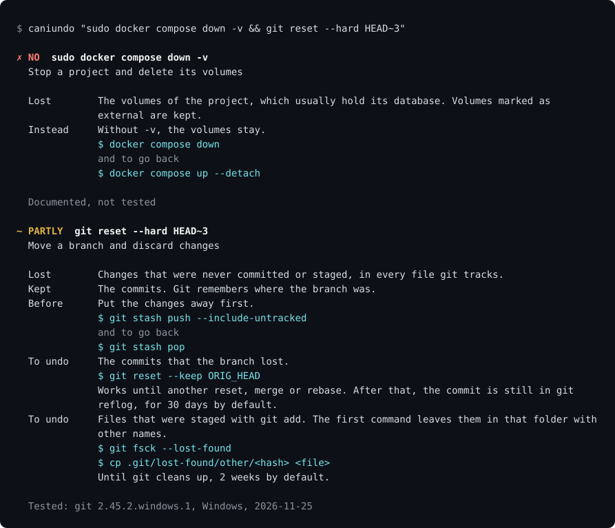

<h1 align="center" id="title">CANIUNDO</h1>

<p align="center"></p>

<p id="description">One command can delete a database, a branch or a week of work, and most tools only tell you that it is dangerous. caniundo tells you what would be lost, what to do instead and how to get it back. It is an open database that anyone can extend, and an entry is only called tested when its recipes were really run and everything came back. It works as a skill for Claude, inside Claude Code, in your terminal and on the web.</p>

<p align="center">
<a href="https://github.com/willor16/caniundo"></a>
<a href="https://github.com/willor16/caniundo/actions/workflows/ci.yml"></a>

<a href="LICENSE"></a>
</p>

<p align="center"><a href="README.es.md">🌎 Leer en español</a></p>

<h2>🚀 Demo</h2>

[willor16.github.io/caniundo](https://willor16.github.io/caniundo/)

<h2>📸 Project Screenshots:</h2>

<p align="center"></p>

<h2>🧐 Features</h2>

Some of the project's best features:

*   99 commands, 53 of them tested so far
*   Says what is lost, what stays, what to do instead and how to undo it
*   Finds the command inside `sudo`, `bash -c`, `docker exec`, `xargs`, `ssh` and others
*   A skill for Claude.ai, Claude Desktop and Claude Code, with nothing to install
*   Stops Claude Code before it runs something that cannot be undone
*   Reads Bash, PowerShell and SQL
*   Everything in English and Spanish

<h2>🛠️ Installation Steps:</h2>

You need [Node.js](https://nodejs.org) 20 or later.

<p>1. Clone the repository</p>

```sh
git clone https://github.com/willor16/caniundo.git
cd caniundo
```

<p>2. Install the command</p>

```sh
npm install -g .
```

<h2>💡 Usage:</h2>

```sh
caniundo "docker compose down -v"     # what would be lost
caniundo oops "deleted branch"        # how to recover
caniundo list git                     # what is in the database
```

Add `--json` for other programs. The exit code is 0 when everything comes back, 1 when something does not, 2 for wrong use and 3 when nobody knows.

<h2>🧠 Skill for Claude:</h2>

Claude reads the database and answers from it: before a command, or after something went wrong. It needs no program and no network.

| Where | How |
| --- | --- |
| Claude.ai and Claude Desktop | Download [caniundo-skill.zip](https://willor16.github.io/caniundo/caniundo-skill.zip) and upload it in the Skills section of the settings |
| Claude Code | Copy [skills/caniundo](skills/caniundo) to `~/.claude/skills/`, or install the plugin below, which includes it |

Then ask in your own words, for example *"I ran git stash drop by mistake, can I get it back?"*

<h2>🤖 Claude Code:</h2>

```
/plugin marketplace add willor16/caniundo
/plugin install caniundo@caniundo
```

Before a command that cannot be undone, Claude Code shows you what would be lost and waits. The plugin also brings the skill.

| Mode | What happens |
| --- | --- |
| `ask` (default) | You decide, with the facts in front of you |
| `steer` | Claude is stopped and told a safer way |
| `note` | Nobody is stopped, but Claude knows how to go back |

Everyday commands, such as `rm -rf node_modules` or `git commit`, never interrupt.

<h2>🧪 What "tested" means:</h2>

Each proof runs in a temporary folder, and every step has to hold:

1.   Something valuable exists, and a check sees it
2.   The command runs
3.   The check fails, so something was really lost
4.   The recipe runs, exactly as you read it
5.   The check passes again

Nobody writes "tested" by hand. If a recipe changes, its evidence is no longer valid and the entry goes back to "documented" until the proof runs again.

<h2>🔍 What it covers:</h2>

| | |
| --- | --- |
| 🌿 Code | Git, GitHub |
| 📁 Files | Linux, macOS, Windows, PowerShell |
| 🗄️ Data | PostgreSQL, MySQL, SQLite, Redis, MongoDB |
| 📦 Containers | Docker, Kubernetes, Helm |
| ☁️ Cloud | AWS, Google Cloud, Azure, Terraform, Railway, Heroku, Fly.io, Supabase, Vercel |
| 🚚 Packages | npm, Cargo, PyPI |

<h2>🔒 How it stays safe:</h2>

*   It reads the command and never runs it
*   No network, no account, no telemetry and no install scripts
*   The hook can ask or stop, but never approves a command
*   A recipe is always one plain command, from a short list of programs, with nothing hidden in it
*   A recipe that could lose something has to say so
*   The proofs receive no tokens from the environment

<h2>⚠️ Limits:</h2>

*   What is not in the database is "not known", never "safe"
*   It cannot see inside a script, or a variable that only has a value when it runs
*   It does not look at your folder, so it warns even when there was nothing to lose
*   Your version or your settings can behave in another way. Keep a copy of what matters
*   It is a seat belt and not a sandbox

<h2>🍰 Contribution Guidelines:</h2>

An entry is a single YAML file, in English and Spanish. The skill, the plugin and the website are generated from those files. See [CONTRIBUTING.md](CONTRIBUTING.md) and [SECURITY.md](SECURITY.md).

<h2>💻 Built with</h2>

Technologies used in the project:

*   TypeScript
*   Node.js
*   GitHub Actions
*   YAML

<h2>🛡️ License:</h2>

This project is licensed under the [MIT License](LICENSE).
